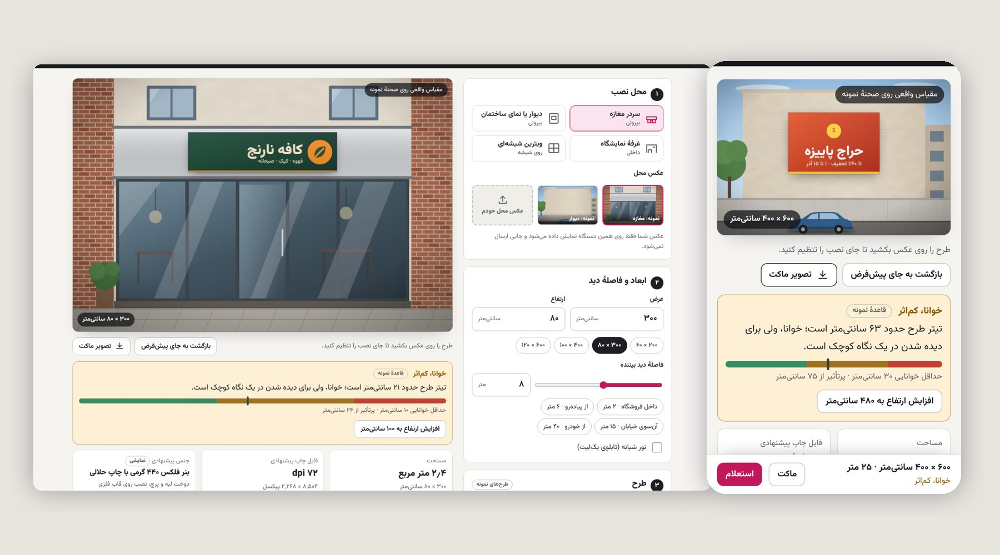

<div align="center">
  <h1>Large-Format Print Mockup Demo</h1>
  <p><b>A Persian, right-to-left, phone-first web demo: the customer enters the installation size, viewing distance and site, sees the design on a photo of the site at real scale, checks readability and print-file resolution, and prepares a test inquiry.</b></p>
  <p>Proposal demo by <b>DARIUSH Digital Studio</b> for <b>Cafe Print</b> · scenes, materials and rules are sample data; this is not Cafe Print's official site</p>
  <p>
    <a href="https://dariush-tech.github.io/cafeprint-mockup-demo/"><b>Live demo</b></a> ·
    <a href="#demo-flow">Demo flow</a> ·
    <a href="#rules">Rules</a> ·
    <a href="#run-locally">Run locally</a>
  </p>
  <p>
    
    
    
    
    
  </p>
  
</div>

<div dir="rtl">

### خلاصه

دموی پیشنهادی DARIUSH Digital Studio برای سفارش‌های چاپ عریض کافه‌پرینت. مشتری محل نصب (سردر مغازه، دیوار یا نمای ساختمان، غرفهٔ نمایشگاه یا ویترین شیشه‌ای)، ابعاد و فاصلهٔ دید را وارد می‌کند و طرح نمونه یا طرح خودش را با مقیاس واقعی روی صحنهٔ نمونه یا عکس محل خودش می‌بیند و جابه‌جا می‌کند. صفحه خوانایی تیتر را با فاصلهٔ دید می‌سنجد و راه اصلاح پیشنهاد می‌کند، رزولوشن و ابعاد پیکسلی فایل چاپ، جنس و پرداخت پیشنهادی و نیاز به چاپ چندتکه را نشان می‌دهد و تصویر ماکت را می‌سازد. در پایان، برگهٔ استعلام با «کپی خلاصه» و «ثبت استعلام آزمایشی» و کد پیگیری کار می‌کند. عکس و طرح مشتری فقط در همان مرورگر می‌ماند.

</div>

## Demo flow

1. **Try the sample.** «امتحان با نمونه» puts a 300 × 80 cm cafe sign on a shopfront seen from 8 m. The title is readable but small, and one tap on the suggested fix raises the sign to 100 cm, which turns the check green.
2. **Site.** Four site types, each with a sample scene drawn to a known scale, or the customer's own photo (resized and shown locally, never uploaded) with a size slider.
3. **Size and viewing distance.** Width and height in centimetres (Persian or Latin digits), quick presets per site, and a viewing distance from 0.5 to 200 m with common presets.
4. **Design.** Three sample designs that re-lay themselves for any proportion, or the customer's own design image with an optional smallest-text height.
5. **Mockup.** The design sits on the photo at real scale on the sample scenes; drag it (or use the arrow keys) to place it. «تصویر ماکت» renders a full-size image of the mockup to save and send.
6. **Inquiry.** Site, size, area, viewing distance, suggested material and finishing, print-file resolution, readability, design, quantity and installation, with copy summary and a test submission that returns a code such as `CP-5101`.

## Rules

All rules live in plain objects at the top of the script and can be edited without a build step. They are sample values, not Cafe Print's specifications.

| Rule | Sample value |
|---|---|
| Minimum readable letter height | 1.2 cm per metre of viewing distance |
| Letter height for impact | 3 cm per metre of viewing distance |
| Print-file resolution | 150 dpi under 1.5 m · 100 under 4 m · 72 under 10 m · 45 under 25 m · 25 beyond |
| Roll width for one-piece printing | 320 cm for flex and fabric, 137 cm for perforated window film |
| Material by site | flex banner (fascia), mesh banner over 10 m² (wall), tension fabric (booth), one-way vision film (window); backlit fabric when night lighting is on |

## Notes

- The sample scenes are illustrations drawn to a known scale; on the customer's own photo the scale is approximate.
- No phone number, account or payment. The inquiry stays in the visitor's browser and nothing is sent.
- Light and dark themes, phone and desktop layouts, keyboard-movable mockup.

## Project structure

```
cafeprint-mockup-demo/
├── index.html   # markup, styles, scenes, rules and scripts (single file, no build step)
└── docs/        # README media
```

## Run locally

```bash
git clone https://github.com/dariush-tech/cafeprint-mockup-demo.git
cd cafeprint-mockup-demo
python3 -m http.server 8000
# open http://localhost:8000
```

---

Design & development: [Dariush Technology](https://github.com/dariush-tech) · DARIUSH Digital Studio
